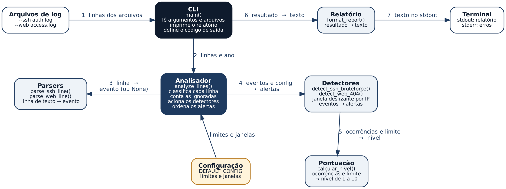

# Sprint 3 — Arquitetura e desenvolvimento

**Projeto:** LogSentinel — Analisador de logs e identificação de atividades suspeitas

Nesta sprint definimos a arquitetura do sistema e implementamos as quatro histórias de usuário. Os 36 testes da Sprint 2 passam, incluindo os 10 de integração com logs reais (SSH e Apache).

## 1. Diagrama da arquitetura



## 2. Componentes e responsabilidades

| Componente | Funções em `logsentinel.py` | Responsabilidade | Recebe → entrega |
|---|---|---|---|
| CLI | `main()` | Lê os argumentos (`--ssh`, `--web`, `--ano`), abre os arquivos, trata erros de leitura, imprime o relatório e define o código de saída | argumentos → relatório no terminal e código 0 ou 1 |
| Analisador | `analyze_lines()` | Coordena a análise: classifica cada linha, conta as ignoradas, aciona os detectores e ordena os alertas | linhas, config e ano → resultado |
| Parsers | `parse_ssh_line()`, `parse_web_line()` | Transformam uma linha de texto em um evento, ou devolvem `None` se a linha não for reconhecida | linha → evento ou `None` |
| Detectores | `detect_ssh_bruteforce()`, `detect_web_404()` | Agrupam os eventos por IP e procuram, com janela deslizante, o momento com mais ocorrências | eventos e config → alertas |
| Pontuação | `calcular_nivel()` | Converte o número de ocorrências e o limite em um nível de 1 a 10 | ocorrências e limite → nível |
| Relatório | `format_report()` | Monta o texto do relatório, do alerta mais suspeito ao menos suspeito | resultado → texto |
| Configuração | `DEFAULT_CONFIG` | Guarda os limites e as janelas de tempo padrão | (dados) |

## 3. Comunicação entre os componentes

1. O **CLI** lê os arquivos informados e junta as linhas.
2. O CLI chama o **Analisador** com as linhas e o ano dos registros SSH.
3. Para cada linha, o Analisador chama os **Parsers**: primeiro o SSH, depois o web. Se nenhum reconhece a linha, ela é contada como ignorada.
4. Com os eventos prontos, o Analisador chama os **Detectores**, passando a configuração, e recebe os alertas.
5. Cada Detector chama a **Pontuação** para calcular o nível do alerta.
6. O Analisador ordena os alertas e devolve o resultado ao CLI, que chama o **Relatório**.
7. O CLI imprime o texto no terminal. Erros vão para o `stderr`.

Os dados trocados entre os componentes são dicionários simples:

- **Evento SSH:** `tipo` (`ssh_falha` ou `ssh_sucesso`), `ip`, `usuario`, `horario`.
- **Evento web:** `tipo` (`web`), `ip`, `horario`, `metodo`, `caminho`, `status`.
- **Alerta:** `ip`, `fonte` (`ssh` ou `web`), `inicio`, `fim`, `ocorrencias`, `motivo`, `nivel`, `evidencias`.
- **Resultado:** `alertas` (lista) e `linhas_ignoradas` (número).

## 4. Histórias implementadas

| História | Onde está no código | Status |
|---|---|---|
| US01 — Falhas repetidas de login SSH | `parse_ssh_line`, `detect_ssh_bruteforce` | Implementada, testes passando |
| US02 — Excesso de 404 no log web | `parse_web_line`, `detect_web_404` | Implementada, testes passando |
| US03 — Relatório com evidências | `calcular_nivel`, `format_report` | Implementada, testes passando |
| US04 — Arquivo na linha de comando | `main`, `analyze_lines` (linhas inválidas) | Implementada, testes passando |

## 5. Decisões de projeto

- **Janela deslizante.** Para cada IP, os eventos são ordenados por horário e se procura o trecho com mais ocorrências cuja duração não passa da janela (60 s por padrão). Gera alerta se esse trecho tem pelo menos o limite de ocorrências.
- **Um alerta por IP.** O alerta descreve a janela mais cheia daquele IP. Por isso o IP `183.62.140.253`, com 286 falhas no total, aparece com 32 ocorrências: é o que aconteceu no pior minuto.
- **Nível de suspeita.** `nível = 10 × ocorrências ÷ (3 × limite)`, arredondado para baixo e limitado entre 1 e 10. Com 3 vezes o limite o nível chega a 10. Exemplos: limite 5 com 12 falhas dá 8; limite 10 com 14 respostas 404 dá 4.
- **Desempate na ordem.** Alertas de mesmo nível são ordenados pelo número de ocorrências e depois pelo IP.
- **Tipo de linha reconhecido linha a linha.** `--ssh` e `--web` organizam a entrada, mas o Analisador reconhece o tipo de cada linha sozinho.
- **Ano.** O log SSH não traz o ano, então `--ano` informa o ano (padrão 2026).
- **Fuso horário do log web ignorado.** Vale o horário escrito na linha, e todas as linhas de um arquivo têm o mesmo fuso.
- **Logins bem-sucedidos.** São lidos (`ssh_sucesso`), mas não contam como falha.
- **Linhas em branco.** Não contam como linhas ignoradas.

## 6. Demonstração no terminal

Análise do log SSH real (2000 linhas):

```text
$ python logsentinel.py --ssh data/OpenSSH_2k.log
=== LogSentinel - Relatório de análise ===
9 alerta(s), do mais para o menos suspeito.

IP analisado: 183.62.140.253
Fonte: SSH
Período: 10/12, das 10:59:10 às 11:00:10
Ocorrências: 32
Motivo: Falhas repetidas de autenticação SSH
Nível de suspeita: 10/10
Evidências:
  - 10/12 10:59:10 senha incorreta (usuário: root)
  - 10/12 10:59:11 senha incorreta (usuário: root)
  - 10/12 10:59:12 senha incorreta (usuário: root)
  - 10/12 10:59:15 senha incorreta (usuário: root)
  - 10/12 10:59:17 senha incorreta (usuário: root)
  (e mais 27)

IP analisado: 112.95.230.3
...

Linhas ignoradas: 1482
```

Análise do log web real (10000 registros):

```text
$ python logsentinel.py --web data/apache_logs.txt
=== LogSentinel - Relatório de análise ===
1 alerta(s), do mais para o menos suspeito.

IP analisado: 144.76.95.39
Fonte: Web
Período: 20/05, das 09:05:04 às 09:05:48
Ocorrências: 14
Motivo: Excesso de respostas 404 (busca por páginas escondidas)
Nível de suspeita: 4/10
Evidências:
  - 20/05 09:05:04 GET /misc/nmh//%22file://$file/%22 -> 404
  - 20/05 09:05:04 GET /articles/ssh-???????????????????/ -> 404
  - 20/05 09:05:06 GET /scripts//%22$%7BWEBLOC%7D/view.php/?file=$%7Blinkto%7D%5C%22 -> 404
  - 20/05 09:05:20 GET /scripts//%22$%7BWEBLOC%7D/view.php/?file=$%7Blinkto%7D%5C%22 -> 404
  - 20/05 09:05:20 GET /scripts//%22file://$file/%22 -> 404
  (e mais 9)

Linhas ignoradas: 0
```

Erros tratados com mensagem clara:

```text
$ python logsentinel.py --ssh nao_existe.log
Erro: arquivo não encontrado: nao_existe.log
(código de saída: 1)

$ python logsentinel.py
usage: logsentinel [-h] [--ssh ARQUIVO] [--web ARQUIVO] [--ano ANO]
logsentinel: error: informe ao menos um arquivo com --ssh ou --web
(código de saída: 2)
```

Execução dos testes:

```text
$ python -m unittest test_logsentinel
----------------------------------------------------------------------
Ran 36 tests in 0.102s

OK
```

## 7. Limitações conhecidas

- Logs SSH que atravessam a virada do ano ficam com o ano errado nos registros de janeiro, porque o formato não traz o ano.
- Só se detectam falhas de senha (`Failed password`) e respostas 404. Outros sinais, como `Failed publickey` ou 403, não são analisados.
- As linhas `message repeated N times` do SSH são ignoradas, então esses casos subestimam as falhas.
- Os alertas de SSH e web de um mesmo IP não são relacionados entre si.
- O arquivo é lido inteiro na memória, o que é suficiente para logs de servidores pequenos.
- A análise é feita em arquivos já salvos, sem monitoramento em tempo real nem bloqueio automático.

## 8. Próxima etapa (Sprint 4)

O código atual funciona, mas ainda tem pontos naturais de refatoração, que são candidatos a padrões de projeto a decidir e justificar na Sprint 4:

- `detect_ssh_bruteforce` e `detect_web_404` seguem o mesmo roteiro (filtrar, agrupar, achar a janela, montar o alerta) e diferem em poucos detalhes.
- A escolha do parser em `analyze_lines` é uma sequência de tentativas que cresce a cada novo formato de log.
- A montagem do texto em `format_report` mistura formatação e regras do relatório.
