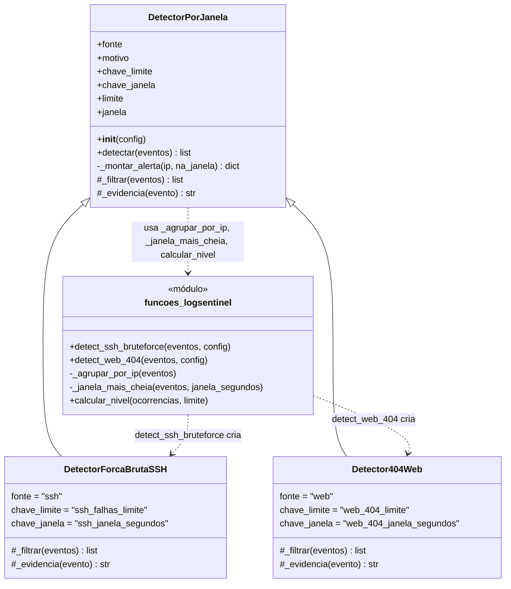
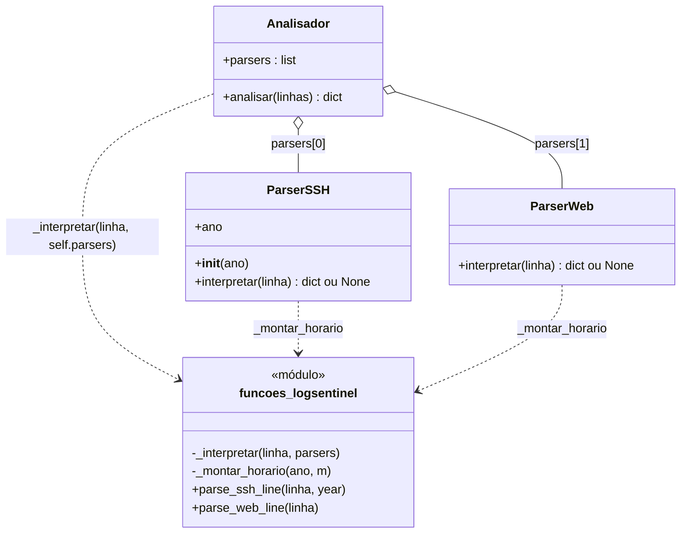
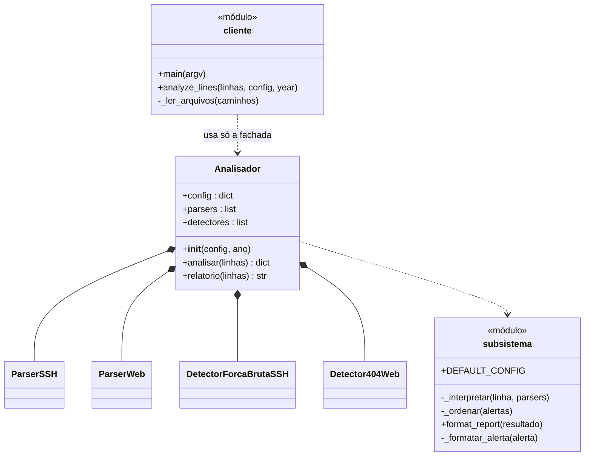

# Sprint 4 — Refatoração e padrões de projeto

**Projeto:** LogSentinel — Analisador de logs e identificação de atividades suspeitas

Nesta sprint refatoramos o código da Sprint 3 em passos pequenos, sem reescrever o sistema, e aplicamos três padrões de projeto: Template Method, Chain of Responsibility e Facade. Os 36 testes da Sprint 2 continuam passando depois de cada passo, sem nenhuma mudança nos testes, e a saída do programa para os dois logs de referência é idêntica à da Sprint 3.

## 1. Refatorações realizadas

O ponto de partida foram os três problemas anotados na seção 8 do documento da Sprint 3. A interface pública (`parse_ssh_line`, `parse_web_line`, `detect_ssh_bruteforce`, `detect_web_404`, `calcular_nivel`, `analyze_lines`, `format_report`, `main` e `DEFAULT_CONFIG`) foi mantida: essas funções continuam existindo e agora delegam para as classes novas. Eventos e alertas continuam sendo dicionários, no mesmo formato descrito na Sprint 3.

| Passo | O que mudou | Refatoração | Padrão |
|---|---|---|---|
| 1 | O roteiro repetido em `detect_ssh_bruteforce` e `detect_web_404` (filtrar, agrupar, achar a janela, montar o alerta) foi para a classe `DetectorPorJanela`; as diferenças ficaram em `DetectorForcaBrutaSSH` e `Detector404Web` | Extract Superclass, Replace Function with Class | Template Method |
| 2 | O `try/except` de `datetime` repetido nos dois parsers foi para `_montar_horario` | Extract Function | — |
| 3 | Os parsers viraram as classes `ParserSSH(ano)` e `ParserWeb`, com o mesmo método `interpretar(linha)` | Replace Function with Class | Chain of Responsibility |
| 4 | O `parse_ssh_line(...) or parse_web_line(...)` de `analyze_lines` foi trocado por `_interpretar(linha, parsers)`, que percorre uma lista | Substitute Algorithm | Chain of Responsibility |
| 5 | A montagem do texto de um alerta saiu de `format_report` para `_formatar_alerta` | Extract Function | — |
| 6 | A montagem do config, dos parsers e dos detectores e a análise passaram para a classe `Analisador`; `analyze_lines` e `main` usam só ela | Introduce Facade | Facade |
| 7 | A leitura dos arquivos saiu de `main` para `_ler_arquivos` | Extract Function | — |

O histórico de commits desta sprint mostra cada um desses passos.

## 2. Padrões de projeto

### 2.1 Template Method — detectores

**Problema.** `detect_ssh_bruteforce` e `detect_web_404` tinham o mesmo algoritmo, linha por linha. Mudavam só o filtro dos eventos, o texto da evidência, a fonte, o motivo e as chaves do config. Um detector novo (por exemplo, respostas 403 ou `Failed publickey`) exigiria copiar a janela deslizante mais uma vez.

**Solução.** `DetectorPorJanela.detectar()` é o método template: fixa a ordem dos passos e chama `_filtrar()` e `_evidencia()`, que cada subclasse implementa. As subclasses também definem `fonte`, `motivo`, `chave_limite` e `chave_janela`. A janela deslizante, a regra de limite e o cálculo do nível ficam num só lugar.

**Por que este padrão.** O algoritmo é o mesmo e só alguns passos variam, que é exatamente o caso do Template Method. Um detector novo implementa dois métodos e quatro atributos.



### 2.2 Chain of Responsibility — parsers

**Problema.** O analisador descobre o tipo de cada linha sozinho (decisão da Sprint 3): tenta o parser SSH e, se ele não reconhece, tenta o web. Isso estava escrito como `parse_ssh_line(linha, year) or parse_web_line(linha)`, uma expressão que cresce a cada formato novo. O ano também precisava ser repassado em toda chamada.

**Solução.** `ParserSSH` e `ParserWeb` têm o mesmo método `interpretar(linha)`, que devolve um evento ou `None`. `_interpretar(linha, parsers)` passa a linha pelos parsers em ordem, e o primeiro que reconhece a linha a trata. Se nenhum reconhece, a linha conta como ignorada. O ano agora é estado do `ParserSSH`, informado uma vez na criação.

**Por que este padrão.** A linha percorre uma sequência de tratadores até um deles assumir, e quem envia a linha não sabe qual vai tratá-la. Não é um Strategy porque não se escolhe um algoritmo antes: todos são tentados, na ordem. Usamos a forma em lista, em vez de cada parser guardar o próximo, porque a ordem fica visível num só lugar (`Analisador.parsers`).



Fluxo de uma linha: `_interpretar` chama `ParserSSH.interpretar`; se o resultado for `None`, chama `ParserWeb.interpretar`; se também for `None`, devolve `None` e a linha é contada como ignorada.

### 2.3 Facade — Analisador

**Problema.** Para analisar um log era preciso saber juntar o config padrão com o informado, criar os parsers com o ano certo, chamar cada detector, ordenar os alertas e formatar o relatório. Parte disso estava em `analyze_lines` e parte em `main`, que também lia os arquivos e tratava erros.

**Solução.** A classe `Analisador(config, ano)` monta o config, os parsers e os detectores e oferece só dois métodos: `analisar(linhas)`, que devolve o resultado, e `relatorio(linhas)`, que devolve o texto. `main` agora só lê os argumentos e os arquivos e imprime `Analisador(ano=args.ano).relatorio(linhas)`. `analyze_lines` virou uma chamada a `Analisador(config, year).analisar(linhas)`.

**Por que este padrão.** O subsistema (parsers, detectores, ordenação, relatório) tem várias partes que precisam ser combinadas na ordem certa, e quem usa só quer o resultado. A fachada é o ponto único onde essa combinação acontece: um detector novo entra na lista `detectores` do `Analisador` sem mudar `main`. No diagrama da Sprint 3 ela corresponde ao componente "Analisador".



## 3. Arquitetura depois da refatoração

Os componentes da Sprint 3 continuam os mesmos; mudou onde cada um está no código.

| Componente | Sprint 3 | Sprint 4 |
|---|---|---|
| CLI | `main()` | `main()`, `_ler_arquivos()` |
| Analisador | `analyze_lines()` | classe `Analisador` (`analyze_lines` delega) |
| Parsers | `parse_ssh_line()`, `parse_web_line()` | `ParserSSH`, `ParserWeb`, `_interpretar()` |
| Detectores | `detect_ssh_bruteforce()`, `detect_web_404()` | `DetectorPorJanela`, `DetectorForcaBrutaSSH`, `Detector404Web` |
| Pontuação | `calcular_nivel()` | sem mudança |
| Relatório | `format_report()` | `format_report()`, `_formatar_alerta()` |
| Configuração | `DEFAULT_CONFIG` | sem mudança (lido pelo `Analisador`) |

## 4. Testes

Os testes não foram alterados nesta sprint (apenas a docstring do topo, que ainda dizia que eles deviam falhar). A relação entre testes e critérios de aceitação continua a do documento da Sprint 2.

```text
$ python -m unittest test_logsentinel
----------------------------------------------------------------------
Ran 36 tests in 0.100s

OK
```

Também comparamos a saída de `python logsentinel.py --ssh data/OpenSSH_2k.log --web data/apache_logs.txt` antes e depois da refatoração: o texto é idêntico.

## 5. Diagramas

Os três diagramas acima estão em Mermaid, que o GitHub desenha direto neste arquivo. Para o PDF final, eles são exportados como imagem a partir deste arquivo.
